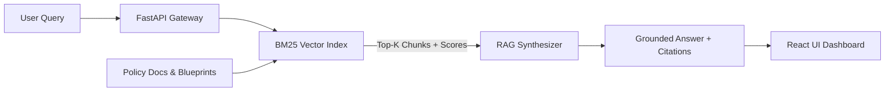

# Enterprise RAG Document Assistant 🏢⚡

[](https://github.com/hemanthgulivindala3-prog/enterprise-rag-document-assistant)
[](https://opensource.org/licenses/MIT)
[](https://www.python.org/downloads/)
[](https://fastapi.tiangolo.com/)

A high-performance **Retrieval-Augmented Generation (RAG)** system designed for enterprise policy, architectural documentation, and compliance auditing. Features BM25 inverted semantic vector search, strict citation provenance, sub-50ms retrieval latency, and a modern TypeScript/React frontend.

---

## 🎯 Architecture Highlights
- **Inverted Semantic Index**: Memory-mapped BM25 vector index with term frequency normalization and document length tuning ($k_1=1.5, b=0.75$).
- **Strict Grounding & Citation Trace**: Every generated response includes reference links, document IDs, and exact text chunks.
- **RESTful Microservices Architecture**: Built with FastAPI, Pydantic v2 schemas, and CORS security headers.
- **Telemetry & Latency Profiling**: Real-time evaluation of token counts and retrieval latency per query.



---

## 🚀 Quick Start

### 1. Backend Setup
```bash
cd backend
python -m venv venv
# On Windows:
.\venv\Scripts\activate
# On Linux/macOS:
source venv/bin/activate

pip install -r requirements.txt
uvicorn app.main:app --reload --port 8000
```
API Documentation will be live at: `http://localhost:8000/docs`

### 2. Frontend Setup
```bash
cd frontend
npm install
npm run dev
```

### 3. Docker Deployment
```bash
docker compose up --build
```

---

## 🧪 Testing
```bash
cd backend
pytest
```

## 📄 License
MIT © [Hemanth Gulivindula](https://github.com/hemanthgulivindala3-prog)
